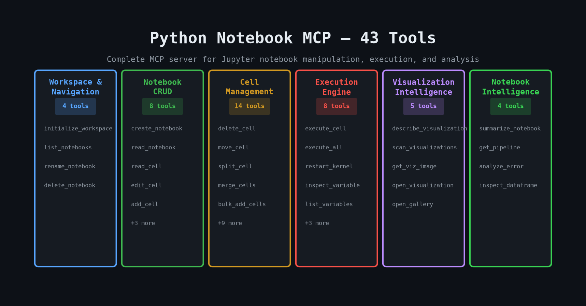
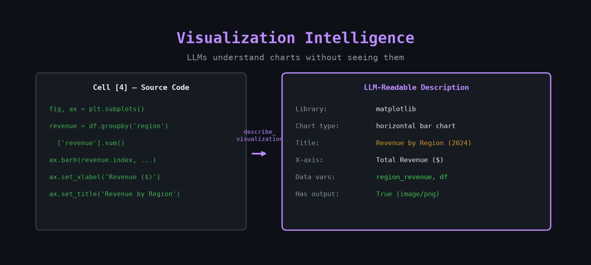
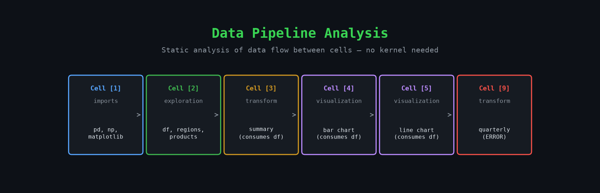
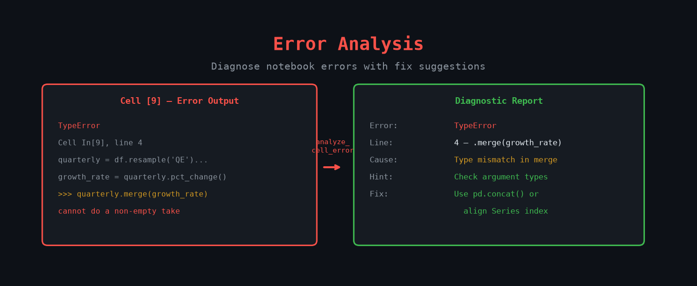
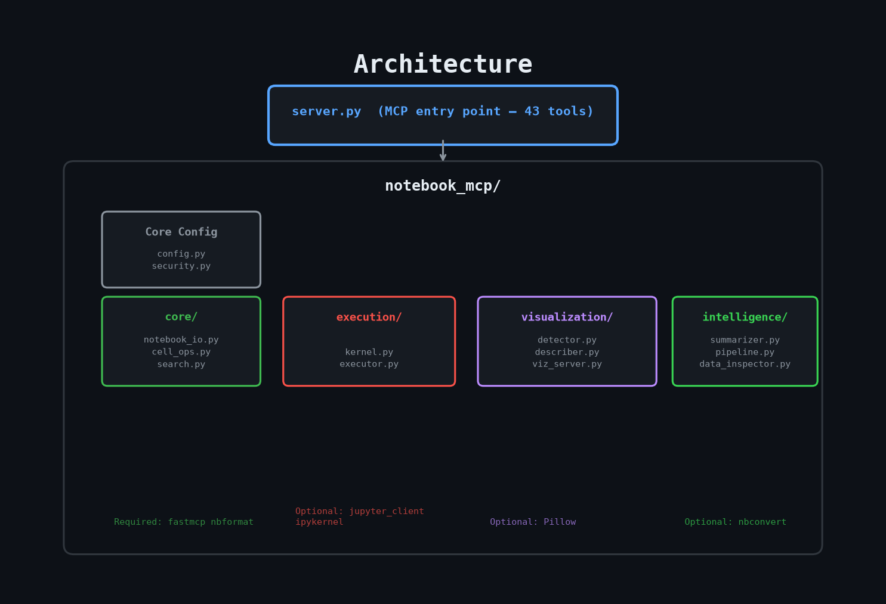

<div align="center">
  <h1>Python Notebook MCP</h1>
  <p>Advanced AI-powered MCP server for Jupyter notebooks — execution, visualization intelligence, and deep notebook analysis.</p>
  <p>
    <a href="LICENSE"></a>
    
    
    
    <a href="https://mseep.ai/app/286d0c4c-dcec-477b-bc2c-b20d2ce85ef2"></a>
    <a href="CodeRabbit Pull Request Reviews"></a>
  </p>
</div>
<div align="center">
<a href="https://mseep.ai/app/usamak98-python-notebook-mcp"></a>
</div>

A Model Context Protocol (MCP) server that gives AI assistants (Claude, Cursor, Windsurf, OpenCode, and any MCP-compatible client) deep, intelligent access to Jupyter notebooks. Goes beyond basic read/write to provide **cell execution**, **visualization intelligence**, **data pipeline analysis**, and more — across 43 tools.

<div align="center">
  
</div>

---

## What makes this different

Most notebook MCP servers stop at reading and writing `.ipynb` files. This server adds three layers that no other file-based notebook MCP provides:

| Capability | What it means |
|---|---|
| **Execution Engine** | LLMs can run cells, capture outputs, inspect variables, and restart kernels — full interactive session support |
| **Visualization Intelligence** | Instead of returning `[Base64 image]`, the server **describes** what a chart shows: type, axes, title, data variables, library — so LLMs understand the output without seeing it |
| **Browser Visualization** | Open any plot in a local browser window on demand — interactive Plotly/Bokeh charts served as live HTML |
| **Notebook Intelligence** | Static analysis of data pipelines, error diagnostics with fix hints, notebook summarization — no kernel needed |

<div align="center">
  
  <br/>
  <em>describe_visualization extracts chart type, axes, title, and data variables from source code — no image processing needed</em>
</div>

---

## Prerequisites

- **Python 3.10+**
- **`uv`** (recommended) — fast Python package/venv manager

```bash
# macOS / Linux
curl -LsSf https://astral.sh/uv/install.sh | sh

# Windows (PowerShell)
powershell -c "irm https://astral.sh/uv/install.ps1 | iex"
```

---

## Setup

### 1. Clone and install

```bash
git clone https://github.com/UsamaK98/python-notebook-mcp.git
cd python-notebook-mcp
```

**Option A — Automated (recommended):**
```bash
# macOS / Linux
bash ./install_unix.sh

# Windows (PowerShell)
.\install_windows.ps1
```

**Option B — Manual:**
```bash
uv venv
source .venv/bin/activate        # macOS/Linux
# .venv\Scripts\Activate.ps1    # Windows PowerShell

uv pip install -r requirements.txt
```

### 2. Optional dependencies

The core server works without extra packages. Enable additional capabilities by installing optional groups:

```bash
# Cell execution (execute_cell, execute_all, inspect_variable, etc.)
uv pip install jupyter_client ipykernel

# Image resizing for visualization tools (get_visualization_image)
uv pip install Pillow

# Notebook export (notebook_export to .py / .html / .md)
uv pip install nbconvert

# Everything at once
uv pip install jupyter_client ipykernel Pillow nbconvert
```

---

## Running the Server

```bash
# From the python-notebook-mcp directory
uv run python server.py
```

---

## Client Configuration

### Cursor / Claude Desktop / OpenCode

Create or edit your MCP client's config file (e.g. `.cursor/mcp.json`):

```json
{
  "mcpServers": {
    "jupyter": {
      "command": "/full/path/to/python-notebook-mcp/.venv/bin/python",
      "args": ["/full/path/to/python-notebook-mcp/server.py"]
    }
  }
}
```

> **Windows:** Use `\\.venv\\Scripts\\python.exe` and double-backslash paths.

### Claude Desktop via fastmcp

```bash
fastmcp install server.py --name "Jupyter Notebook MCP"
```

---

## Usage

### Step 1: Initialize the workspace

Every session starts with this call — it sets the directory where notebooks live:

```python
initialize_workspace(directory="/absolute/path/to/your/project")
```

### Step 2: Use any of the 43 tools

```python
# Navigate
list_notebooks()
notebook_info("analysis.ipynb")
notebook_outline("analysis.ipynb")
notebook_search("analysis.ipynb", query="revenue")

# Edit
add_cell("analysis.ipynb", content="df.head()", cell_type="code")
edit_cell("analysis.ipynb", cell_index=3, content="# Updated")
split_cell("analysis.ipynb", cell_index=5, line_number=3)
bulk_add_cells("analysis.ipynb", cells=[
    {"content": "# Section", "cell_type": "markdown"},
    {"content": "import pandas as pd"},
])

# Execute (requires jupyter_client)
execute_cell("analysis.ipynb", cell_index=2)
execute_all("analysis.ipynb")
inspect_variable("analysis.ipynb", variable_name="df")

# Understand visualizations
describe_visualization("analysis.ipynb", cell_index=4)
open_visualization("analysis.ipynb", cell_index=4)   # opens in browser
open_gallery("analysis.ipynb")                        # all plots in browser

# Analyse the notebook
summarize_notebook("analysis.ipynb")
get_notebook_pipeline("analysis.ipynb")
analyze_cell_error("analysis.ipynb", cell_index=7)
```

---

## All 43 Tools

### Workspace & Navigation

| Tool | Description |
|---|---|
| `initialize_workspace` | **Required first call.** Sets the absolute workspace path. |
| `list_notebooks` | Recursively lists all `.ipynb` files in the workspace. |
| `rename_notebook` | Rename or move a notebook file. |
| `delete_notebook` | Permanently delete a notebook file. |

### Notebook CRUD

| Tool | Description |
|---|---|
| `create_notebook` | Create a new notebook with a title cell and starter code cell. |
| `read_notebook` | Read complete notebook contents (all cells, metadata, outputs). |
| `read_cell` | Read a specific cell by zero-based index. |
| `edit_cell` | Replace a cell's source content. |
| `add_cell` | Add a code/markdown/raw cell at any position. |
| `read_notebook_outputs` | Read all outputs from all code cells. |
| `read_cell_output` | Read the output(s) of a specific code cell. |
| `notebook_export` | Export to `.py`, `.html`, `.md`, `.rst`, `.tex` via nbconvert. |

### Cell Management

| Tool | Description |
|---|---|
| `delete_cell` | Delete a cell by index. |
| `move_cell` | Move a cell from one index to another. |
| `duplicate_cell` | Duplicate a cell one or more times. |
| `change_cell_type` | Convert between code, markdown, and raw. |
| `split_cell` | Split a cell into two at a given line number. |
| `merge_cells` | Merge a cell with the next cell. |
| `bulk_add_cells` | Add multiple cells in a single operation. |
| `clear_cell_outputs` | Clear outputs from a specific code cell. |
| `clear_all_outputs` | Clear outputs from all code cells. |
| `notebook_search` | Keyword search across all cells with context snippets. |
| `notebook_outline` | Structural outline: headings, functions, classes per cell. |
| `notebook_info` | Statistics: cell counts, output counts, errors, kernel, file size. |
| `notebook_validate` | Validate notebook structure against the nbformat schema. |

### Execution Engine

> Requires: `pip install jupyter_client ipykernel`
>
> The server starts a kernel automatically on first use. One kernel per notebook.

| Tool | Description |
|---|---|
| `execute_cell` | Execute a single code cell; capture and return all outputs. |
| `execute_range` | Execute cells `[start, end]` inclusive. |
| `execute_all` | Execute the entire notebook top to bottom. |
| `restart_kernel` | Restart the kernel, clearing all in-memory state. |
| `interrupt_kernel` | Send an interrupt (Ctrl+C equivalent) to a running kernel. |
| `get_kernel_status` | Check if a kernel is running/idle/dead. |
| `inspect_variable` | Get type, repr, shape, columns, dtype of a kernel variable. |
| `list_kernel_variables` | List all user-defined variables in the kernel namespace. |

### Visualization Intelligence

| Tool | Description |
|---|---|
| `describe_visualization` | Generate a structured text description of a plot: chart type, library, title, axes, data variables, series names. Lets LLMs understand charts without seeing the image. |
| `scan_visualizations` | Scan all cells and return a list of visualization cells with metadata. |
| `get_visualization_image` | Return the base64 image data from a cell (with optional resizing). For vision-capable LLMs (Claude, GPT-4V). |
| `open_visualization` | Open a single plot in the default browser via an on-demand local HTTP server. Interactive Plotly/Bokeh charts served as live HTML. |
| `open_gallery` | Open a gallery of all visualizations in a notebook in the browser. |

### Notebook Intelligence

| Tool | Description |
|---|---|
| `summarize_notebook` | Generate a structured summary: title, domain, data sources, operations, visualizations, execution state. Three detail levels: `brief`, `standard`, `detailed`. |
| `get_notebook_pipeline` | Statically analyse variable data flow between cells and return a pipeline DAG: entry points, transforms, exit points, per-cell roles. |
| `analyze_cell_error` | Parse a stored error traceback, identify the error type, locate the failing line, and return a diagnostic hint with a suggested fix. |
| `inspect_dataframe_output` | Extract DataFrame metadata (columns, shape, row count) from a cell's stored HTML output — no kernel required. |

<div align="center">
  
  <br/>
  <em>get_notebook_pipeline traces variable flow between cells, identifying imports, transforms, and visualizations</em>
</div>

<div align="center">
  
  <br/>
  <em>analyze_cell_error parses tracebacks, locates the failing line, and suggests fixes</em>
</div>

---

## Architecture

<div align="center">
  
</div>

```
server.py                       # MCP entry point (43 tool registrations)
notebook_mcp/
  config.py                     # Global workspace state
  security.py                   # CWE-22 path traversal protection
  core/
    notebook_io.py              # Read/write/atomic + output processing
    cell_ops.py                 # delete/move/split/merge/bulk_add/clear
    search.py                   # search/outline/info/validate/export
  execution/
    kernel.py                   # KernelManager lifecycle (one per notebook)
    executor.py                 # execute_cell/range/all, variable inspection
  visualization/
    detector.py                 # Identify viz cells, detect library/chart type
    describer.py                # Code-aware plot description generator
    image_handler.py            # Base64 image extraction + Pillow resize
    viz_server.py               # On-demand stdlib HTTP server (no extra deps)
  intelligence/
    summarizer.py               # Notebook summarization (static analysis)
    pipeline.py                 # Data-flow DAG extraction
    data_inspector.py           # Error analysis + DataFrame output parsing
```

**Optional dependency map:**

| Feature group | Install |
|---|---|
| Core (read/write/search/cell ops) | `fastmcp nbformat` (default) |
| Cell execution | `+ jupyter_client ipykernel` |
| Image resizing | `+ Pillow` |
| Notebook export | `+ nbconvert` |

---

## Security

- **Workspace jail:** All file operations are restricted to the directory set in `initialize_workspace()`. Any path escaping the workspace (via `../`, symlinks, or absolute paths) raises `PermissionError`. Protects against CWE-22 Path Traversal.
- **Atomic writes:** Notebooks are written via a temporary file + `os.replace()` to prevent partial writes on crash or disk-full errors.
- **Execution sandboxing:** Cell execution uses the standard `jupyter_client` protocol. No code is `exec()`-ed by the server itself.
- **Output size caps:** stdout and image data are truncated at 1 MB per output field to prevent memory exhaustion.

---

## Development

```bash
# Install dev dependencies
uv pip install pytest pytest-asyncio

# Run all tests
uv run python -m pytest tests/ -v

# Run a specific test file
uv run python -m pytest tests/test_cell_ops.py -v

# FastMCP inspector (interactive testing)
uv run fastmcp dev server.py
```

**Test coverage:**

| File | Tests | Coverage |
|---|---|---|
| `tests/test_security.py` | 14 | Path resolution, workspace jail, symlink escape |
| `tests/test_cell_ops.py` | 27 | delete/move/split/merge/bulk/clear |
| `tests/test_search.py` | 13 | search/outline/info/validate |
| `tests/test_visualization.py` | 16 | detector/describer (library, chart type, description) |
| `tests/test_intelligence.py` | 17 | summarizer/pipeline/error analysis |
| **Total** | **87** | 86 pass, 1 skipped (symlinks on Windows) |

---

## License

MIT License — see [LICENSE](LICENSE) for details.
